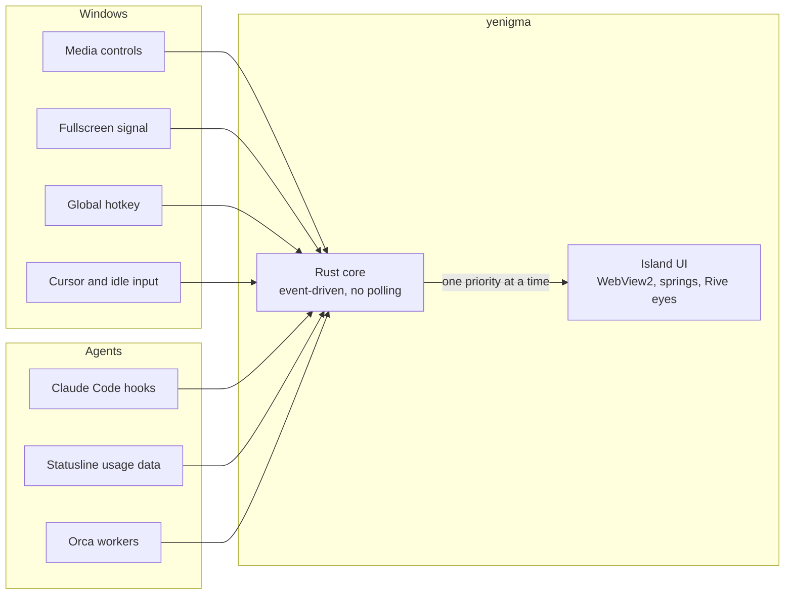

<div align="center">


<br>

**A Dynamic Island for Windows with a pair of eyes, a sense of priority, and a direct line to your AI agents.**

<br>


<br><br>

[Overview](#overview) &nbsp;&nbsp; [Features](#features) &nbsp;&nbsp; [How it works](#how-it-works) &nbsp;&nbsp; [Principles](#principles) &nbsp;&nbsp; [Roadmap](#roadmap) &nbsp;&nbsp; [License](#license)

</div>

<br>

## Overview

**yenigma** lives in a small black notch at the top of your screen. Most of the time it just watches: its eyes follow your cursor, blink, and fall asleep when you step away. When something matters, the notch opens with a spring and shows **one thing**: the most important one right now.

That one thing is often your AI agents. When Claude Code in any project asks a question or needs permission, yenigma tells you which project and what it wants. One click takes you there.

```text
$ yenigma status
agent   ●  daymark        asking: read SQLite directly, or go through a local command?
focus   ◐  24:12          pomodoro 1 of 4
media   ♪  now playing    synced lyrics on
quota   ▰▰▰▰▰▰▰▰▱▱  82%   5-hour window resets in 1h 14m
```

> [!NOTE]
> yenigma is in the design phase. There is no release or installer yet.

<br>

## Features

<table>
<tr>
<td width="50%" valign="top">

**The eyes**<br>
A pair of eyes inside the notch. They track your cursor, blink at random, squint when you focus, and sleep when you go idle. They wake up when an agent needs you.

</td>
<td width="50%" valign="top">

**Priority Now**<br>
The island shows one thing at a time. In order: an agent waiting on you, a finished timer, a running timer, music, then the idle clock.

</td>
</tr>
<tr>
<td valign="top">

**Agent radar**<br>
Global hooks catch Claude Code questions, permission prompts, and finished runs in every project. Orca workers are watched too. Questions queue when several projects ask at once.

</td>
<td valign="top">

**Quota awareness**<br>
Shows how much of Claude's 5-hour and weekly usage you have used, counts down to the reset, and warns you before you hit the limit. It reads data Claude Code already reports, so checking costs nothing extra.

</td>
</tr>
<tr>
<td valign="top">

**Ask on a hotkey**<br>
Press the hotkey and start typing. Your screen is read only when you send. Answers come from `claude -p` on your own subscription or from a custom endpoint.

</td>
<td valign="top">

**Media**<br>
Controls whatever is playing through Windows media controls, with cover art, play and pause, and synced lyrics.

</td>
</tr>
<tr>
<td valign="top">

**Focus**<br>
A pomodoro timer and gentle water reminders. It reads today's tasks from Daymark without changing them, and hides itself when an app goes fullscreen.

</td>
<td valign="top">

**Shelf**<br>
Drop files on the island to park them, then drag them out where you need them. Clipboard history lives here too.

</td>
</tr>
</table>

Every open, close, and click has a small synthesized sound. You can set the volume or mute it.

<br>

## How it works



- **Rust core.** The core talks to Windows (media sessions, fullscreen notifications, hotkeys, input) and to your agents. It turns everything into a small stream of events.
- **Island UI.** The island is a single resident WebView2 surface. Shapes move on springs, and the eyes are a Rive state machine.
- **Window sizing.** The window always matches the island's current bounds. It grows before an opening animation and shrinks after a closing one, so it never blocks clicks and never resizes mid-motion.

<br>

## Principles

| | |
|---|---|
| **Quiet by default** | Near-zero CPU when idle. Rendering stops when the springs settle, and pauses when the island is hidden or in fullscreen, or when the eyes are asleep. |
| **One thing at a time** | The island shows one priority and never a dashboard. |
| **Private by design** | The screen is read only when you send a question. Agent data stays on your machine. |
| **Motion with intent** | Springs answer your actions. Idle motion is sparse, so a notch you see hundreds of times a day never gets tiring. |

<br>

## Roadmap

- [ ] Notch shell: docking, multi-monitor, mixed DPI, hide on fullscreen
- [ ] Eyes: cursor tracking, blink, sleep, wake
- [ ] Agent radar: Claude Code hooks, Orca workers, question queue
- [ ] Quota from statusline data, with warnings
- [ ] Hotkey ask with `claude -p` and a custom endpoint
- [ ] Media controls and synced lyrics
- [ ] Focus timer, water reminders, Daymark tasks
- [ ] File shelf and clipboard history
- [ ] Sound design pass

<br>

## License

Copyright © 2026 DayenM. All rights reserved.
The source is visible here, but it is not open source. See [LICENSE](LICENSE).

<br>

<div align="center">

<br>
<sub>Built by <a href="https://github.com/DayenM">DayenM</a></sub>
</div>
