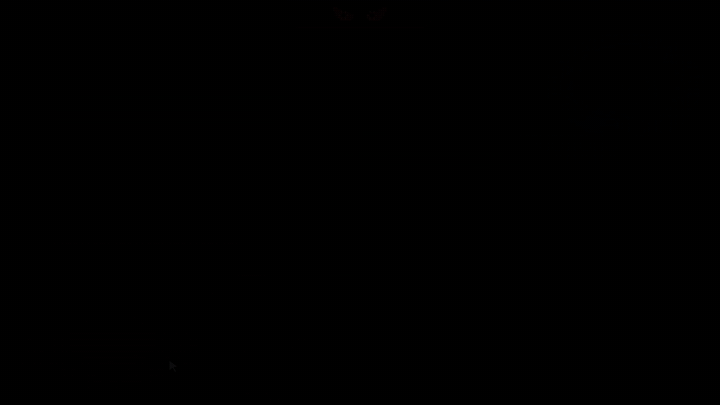
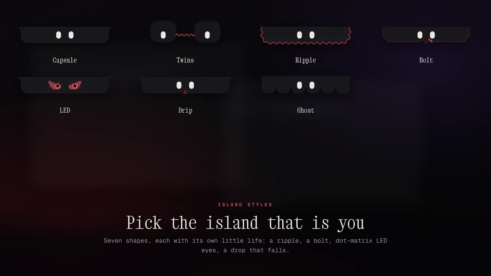
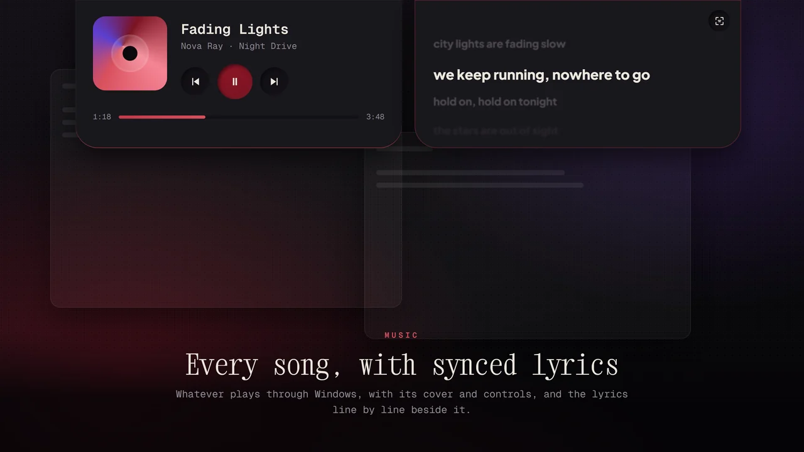
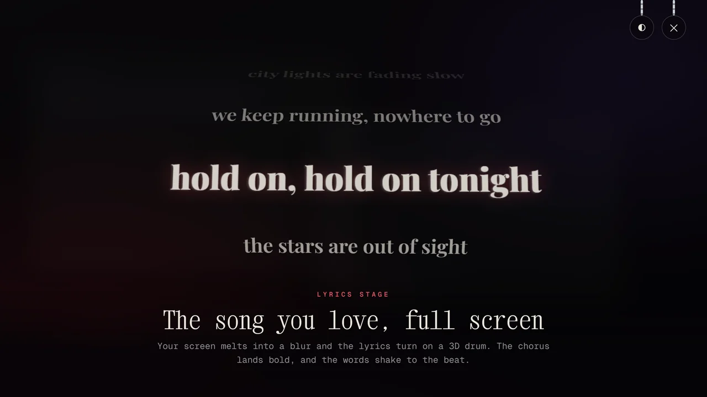
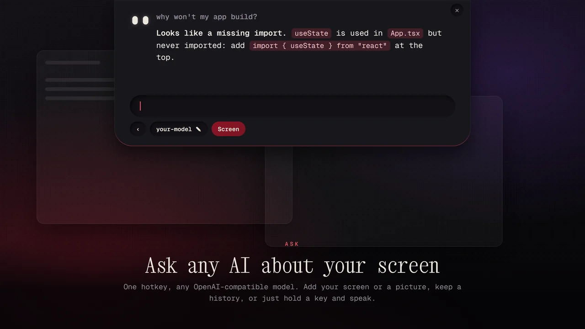
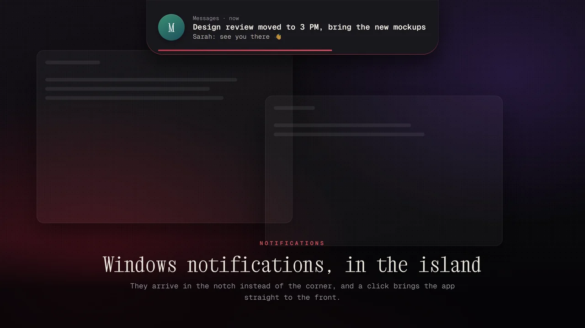
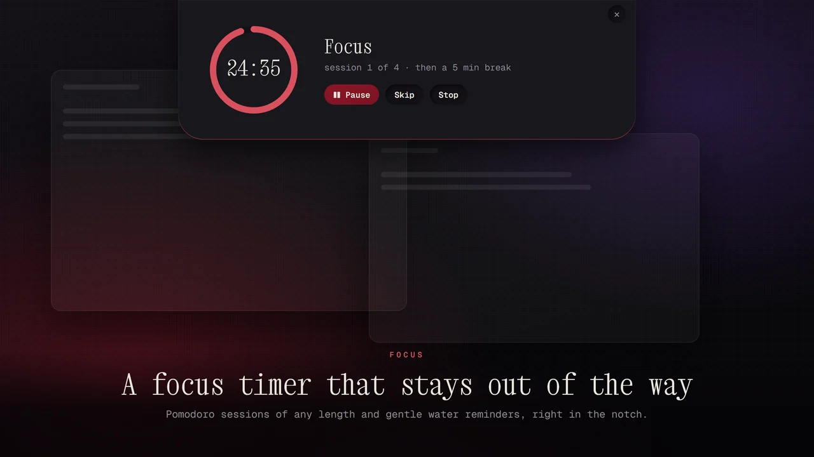
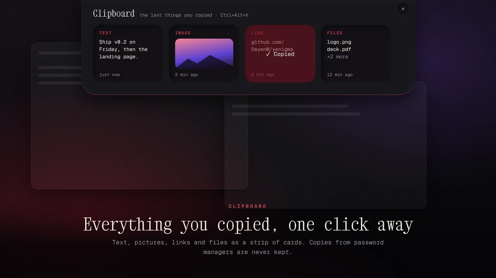
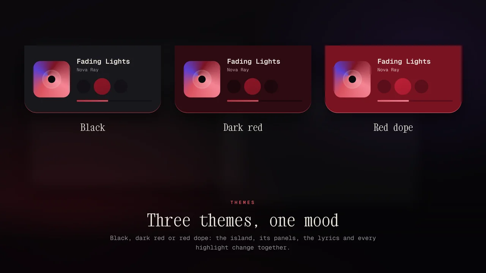

 

**A Dynamic Island for Windows with a pair of eyes, synced lyrics on a full-screen stage, and an AI that answers from wherever you point it.**

 

  

[Download](#download) &nbsp;&nbsp; [Features](#features) &nbsp;&nbsp; [Lyrics Stage](#the-lyrics-stage) &nbsp;&nbsp; [Shortcuts](#shortcuts) &nbsp;&nbsp; [Privacy](#privacy) &nbsp;&nbsp; [License](#license)

 

## Overview

**yenigma** lives in a small black notch at the top of your screen. Most of the time it just watches: its eyes follow your cursor, blink, and fall asleep when you step away. When something matters, the notch opens with a spring and shows **one thing**: the song that just started, the end of a focus session, a notification, or the answer to a question you asked.

Click it and it opens into a menu: chat, focus, clipboard, notifications. Play music and it becomes a little player with synced lyrics beside it, or a full-screen stage for the lyrics alone.

 
Watch it in full quality: <a href=".github/assets/demo.mp4">demo.mp4</a> · and every island style: <a href=".github/assets/styles.mp4">styles.mp4</a>

 

## Download

1. Get the latest `yenigma_x.y.z_x64-setup.exe` from **[Releases](https://github.com/DayenM/yenigma/releases)**.
2. Run it. It installs for your user only, with no admin rights needed.
3. That's it. yenigma updates itself: when a new version is out, the island tells you, shows what's new, and installs it with one click. Every update is signed and verified before it installs.

> [!NOTE]
> The installer is not code-signed yet, so Windows SmartScreen may say "Windows protected your PC". Choose **More info → Run anyway**. Windows 10 needs the WebView2 runtime, which the installer fetches if it is missing.

 

## Features

<table>
<tr>
<td width="50%" valign="top">

**The eyes** 
A pair of eyes inside the notch. They track your cursor, blink, glance around and sleep when you go idle. Pick the island's look: capsule, twins, ripple, bolt, LED, drip or ghost.

</td>
<td width="50%" valign="top">

**Music and synced lyrics** 
Whatever is playing through Windows media controls (Spotify, YouTube in the browser, and more): cover, controls, and synced lyrics in a box beside the player. Pull the lyrics out into their own window and pin it anywhere.

</td>
</tr>
<tr>
<td valign="top">

**Lyrics Stage** 
One click and your screen melts into a soft blur with nothing but the lyrics, turning on a 3D drum. [More below.](#the-lyrics-stage)

</td>
<td valign="top">

**Ask** 
Press the hotkey and type. Answers come from any OpenAI-compatible endpoint you choose. Add your screen or paste an image, keep a history, hold a key to speak (transcribed on your own PC), and it can even draw in Paint.

</td>
</tr>
<tr>
<td valign="top">

**Notifications** 
Windows notifications arrive in the island instead of the corner, with the app's own banners kept quiet. Click one and the app comes straight to the front.

</td>
<td valign="top">

**Focus** 
A pomodoro timer you can set to any length, gentle water reminders, and the island steps aside when an app goes full screen.

</td>
</tr>
<tr>
<td valign="top">

**Clipboard** 
The last things you copied, as a strip of cards. One click puts one back. Copies from password managers are never kept.

</td>
<td valign="top">

**Three themes and a little personality** 
Black, dark red or red dope: the island, its panels and the lyrics change together. Now and then a greeting, a quote, or a line that fits what you're doing, and every open, close and click has a small synthesized sound.

</td>
</tr>
</table>

 

## The Lyrics Stage

A focus mode for the song you love right now.

- **Your screen, softly blurred.** No wallpaper, no album art: only the lyrics over the screen you were on, faded in smoothly.
- **A 3D drum.** The sung line faces you; past lines roll up and away, the next ones rise from below. Scroll or drag to browse the lyrics and click a line to jump the song there.
- **The chorus lands.** The hook and the title line turn bold while the room dims for a moment. A held note slowly swells and trembles until it ends.
- **Shake Lyrics.** The lyrics shake to the beat of whatever is playing, harder for loud and fast songs, with a ghost trail like a camera shake. Set the power from 0 to 100, or hold **Space** to shake it hard yourself.
- **Themes.** Clear blur, dark cinema, yenigma colours, aurora, or any colour you pick, from a cord hanging next to the Close button.

 

## Shortcuts

| | |
|---|---|
| `Ctrl` `Alt` `Space` | Ask |
| `Ctrl` `Alt` `M` (hold) | Speak a question |
| `Ctrl` `Alt` `F` | Focus timer |
| `Ctrl` `Alt` `V` | Clipboard |
| `Ctrl` `Alt` `H` | Tuck the island away, or bring it back |
| On the stage | `Esc` close · `Space` tap to play/pause, hold to shake · `←` `→` change song · `↑` `↓` or scroll to browse |

 

## Privacy

| | |
|---|---|
| **Your screen** | Read only when you send a question with it, never in the background. |
| **Your AI key** | Kept in Windows Credential Manager, never in a settings file. It only travels over `https://`, or to your own computer. |
| **Your voice** | Transcribed on your PC with Whisper. The audio never leaves it. |
| **Lyrics** | Fetched from [LRCLIB](https://lrclib.net) by song title and artist, and cached on your PC. |
| **No telemetry** | yenigma sends nothing about you anywhere. The only regular request is the update check. |

 

## Light on your PC

| What yenigma is doing | CPU, average | GPU, average | Memory |
|---|---|---|---|
| Idle, watching | under 0.1% | 0% | 195 MB |
| Playing music, player and lyrics open | 3.3% | 3.7% | 192 MB |
| Lyrics Stage, full screen | 5.7% | 16.6% | 230 MB |

The installer is about 4.4 MB.

Measured on one PC (Intel Core i7-12650H, 16 threads, 16 GB RAM, Intel UHD and RTX 3070 Laptop graphics) with a release build, averaged over 45 to 60 seconds. CPU is the share of the whole processor and GPU the busiest GPU engine, as Task Manager shows them. Memory is the private working set. All figures cover yenigma and its WebView2 processes, not the music app or the Windows compositor. Your numbers will differ.

## Built with

A Rust core talks to Windows (media sessions, notifications, full-screen signals, hotkeys, input) and drives one resident WebView2 surface through Tauri 2. Shapes move on springs; rendering stops when they settle, so the island costs next to nothing while it waits.

 

## Support

If yenigma makes your screen a little nicer, a ⭐ on this repository helps other people find it.

 

## License

Copyright © 2026 DayenM. All rights reserved.
yenigma is free to download and use, but it is not open source. See [LICENSE](LICENSE).

 

 
Built by <a href="https://github.com/DayenM">DayenM</a>

